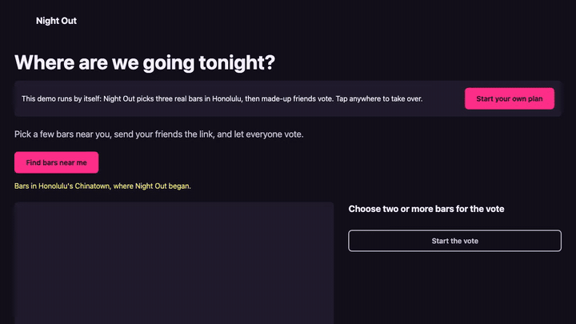

# Night Out



Night Out is for the part of the evening where the group text goes in circles
about where to go. Pick a few bars, send your friends the link, and everyone
votes. The whole plan lives in the link.

[Try it at night-out.joekarlsson.com](https://night-out.joekarlsson.com)

## Quick start

Node.js 20 or newer.

```bash
git clone https://github.com/JoeKarlsson/night-out.git
cd night-out
npm install
npm run dev        # http://localhost:5173
```

With no plan in the link, a demo plays itself; any click, tap or key stops it.

## How it works

- The whole plan, votes included, is encoded in the link (`#p=…`). Voting
  updates the link and you send the new one back to the group. Each phone keeps
  its own vote in `localStorage`, and merges every link it opens for a plan, but
  if two forks both added a vote for the same bar, the merge counts one.
- Bars come from OpenStreetMap through the Overpass API, falling back to
  Nominatim, then to made-up demo bars. The Honolulu demo bars are a snapshot
  in `src/default-bars.js`.
- The friends voting on the vote page are simulated, on screen only, and never
  go into the link. Add `?fast` to the URL to run them 100 times faster.
- The autoplay demo shows a pre-rendered map (`public/demo-map-*.webp`)
  instead of loading MapLibre, which is about 300 KB gzipped. The first
  interaction swaps in the live map.

## Development

```bash
npm test           # unit tests (node:test)
npm run test:e2e   # Playwright: desktop Chrome, Pixel, iPhone WebKit, with axe
npm run icons      # re-render PNG icons and og.png from public/favicon.svg
npm run demo-map   # re-render the demo's static map images (needs cwebp)
```

The e2e tests stub the map style, Overpass and Nominatim, so they make no
outside requests. Visual baselines depend on installed fonts, so they only run
in the Playwright image that matches `@playwright/test`. To update them after a
design change:

```bash
docker run --rm -v "$PWD":/src:ro -v "$PWD/e2e":/out mcr.microsoft.com/playwright:v1.65.0-noble bash -c '
  mkdir /work && cd /src && tar --exclude=node_modules --exclude=dist --exclude=.git -cf - . | (cd /work && tar xf -) && cd /work &&
  npm ci && CI=1 VISUAL=1 npx playwright test e2e/visual.spec.js --update-snapshots &&
  rm -rf /out/visual.spec.js-snapshots && cp -r e2e/visual.spec.js-snapshots /out/'
```

Pushing to `master` runs the tests, builds with Vite and deploys to GitHub
Pages (`.github/workflows/ci.yml`), then checks the live site.

## Credits

First built in 2015 by Joe Karlsson, Jessie Copeland, Alex Anich, Brian
"Boots" and Nolan "Skinny Fatman", and rebuilt as a static site in 2026. Map
data © OpenStreetMap contributors, ODbL. Map tiles from OpenFreeMap, built on
OpenMapTiles.

## License

MIT. See [LICENSE](LICENSE).
